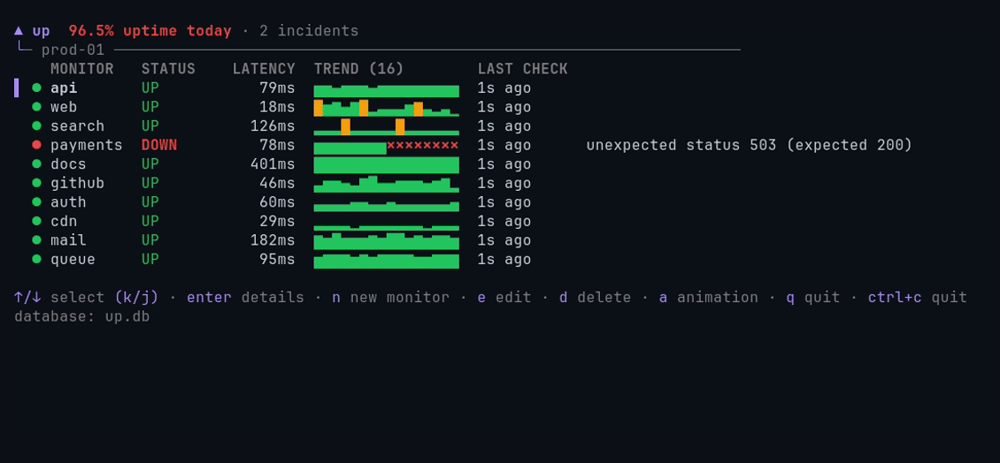

<div align="center">

# up

A self-hosted HTTP uptime monitor with a terminal UI.

[](https://github.com/giulianotesta7/up/actions/workflows/quality.yml)
[](https://github.com/giulianotesta7/up/actions/workflows/security.yml)

</div>

Uptime monitoring that lives in your terminal.
A single Go binary that never stops watching. Close the TUI, walk away, SSH back in hours later, and catch up on everything you missed. No database server, no agents, no YAML.



## Capabilities

- **HTTP checks.** Each monitor has a URL, an interval, a timeout and an expected status
  code. It is UP when the response status equals the expected one within the timeout;
  otherwise it is DOWN with the reason (unexpected status, timeout, connection error).
  Redirects are followed and the final status is compared.
- **Create monitors in the TUI.** Press `n`, fill in the form, save. The running daemon picks
  the new monitor up within about two seconds, without a restart.
- **Edit monitors in the TUI.** Press `e` to change a monitor's URL, interval, timeout or
  expected status without renaming it or restarting the daemon.
- **Delete monitors in the TUI.** Press `d` and confirm to permanently remove a monitor
  and all its history.
- **Status at a glance.** Status, latency, last check and failure reason for every service.
  Open one to see its last error, when it went down, its recent checks and its recent
  outages (`03:12 → 03:40`).
- **History while you were away.** Every result is stored with its time, status, latency and
  error, and outages are derived from it.
- **Stale-daemon detection.** The daemon writes a heartbeat. If it stops, the TUI says so
  and keeps the last known statuses; it never marks services DOWN just because the data is
  old.
- **Retention.** Results older than 30 days are removed automatically (`--retention` changes
  it, `0` keeps everything). Monitor definitions are never removed.

## Install

On Linux (amd64 or arm64):

```console
curl -fsSL https://raw.githubusercontent.com/giulianotesta7/up/main/install.sh | sh
```

The script downloads the release binary, verifies its checksum and installs it in
`/usr/local/bin`. To also run it as a systemd user service, run as your normal user:

```console
curl -fsSL https://raw.githubusercontent.com/giulianotesta7/up/main/install.sh | sh -s -- --service
```

That installs the unit from [`deploy/up.service`](deploy/up.service) in
`~/.config/systemd/user` and starts it as you, using `~/.config/up/up.db`.
It only asks for sudo when the binary directory needs it and to enable linger,
which keeps the service running after logout. If linger fails, follow the printed hint.
Logs are in `journalctl --user -u up -f`.

For a shared system service, use `--system` instead of `--service`:

```console
curl -fsSL https://raw.githubusercontent.com/giulianotesta7/up/main/install.sh | sh -s -- --system
```

This installs [`deploy/up-system.service`](deploy/up-system.service), runs it as the
system user `up`, and shares `/var/lib/up/up.db` through the `up` group. It requires
root privileges and adds the invoking user (or `SUDO_USER`) to that group. When run
as root without `SUDO_USER`, it skips membership changes; add each intended user
with `sudo usermod -aG up USER`. Members can read and change all monitors and history.
Run `newgrp up` to use the TUI in the current shell, or log out and back in. Until
then, use `sudo -u up up tui`. Logs are in `journalctl -u up -f`.
The installer warns when an existing unit lacks `UMask=0007` and fixes permissions of an existing `/var/lib/up/up.db`.

The installer prints a copy command if it finds the invoking user's old database;
it never migrates data automatically. An existing user unit is kept, but the shared
system database takes precedence for `up tui` unless overridden.

Choose the plain binary for manual startup, `--service` for a per-user daemon, or
`--system` for a shared daemon. Other options: `--version vX.Y.Z` to pin a release
and `--uninstall` to remove the binary and units. Databases, the system `up` user
and the `up` group are kept.

To build from source you need Go 1.26.10:

```console
git clone https://github.com/giulianotesta7/up.git
cd up
go build -o up ./cmd/up
```

## Quick start

Start the daemon; an empty database is fine:

```console
up serve
```

In another terminal, open the TUI and press `n` to add your first monitor:

```console
up tui
```

Both commands resolve the database in this order:

1. `--db PATH`, when passed.
2. `UP_DB`, when non-empty.
3. `/var/lib/up/up.db`, when it exists as a regular file.
4. `~/.config/up/up.db`, honoring `XDG_CONFIG_HOME`.

Only the last choice creates the parent directory (mode `0700`). Explicit paths
and `UP_DB` never create parent directories. With either service, `up tui` opens
the matching database with no flags unless you override it. The TUI footer shows
`database: <path>` in every view so you can check which database is open.

### Keys

| Where | Keys |
| --- | --- |
| List | `↑`/`↓` or `k`/`j` select · `enter` details · `n` new monitor · `e` edit · `d` delete · `a` toggle animation · `q` quit |
| Details | `esc` back · `n` new monitor · `e` edit · `d` delete · `a` toggle animation · `q` quit |
| New or edit monitor | `tab`/`shift+tab` change field · `enter` save · `esc` cancel |
| Delete confirmation | `y` delete · `n`/`esc` cancel |

A new monitor needs a name and an HTTP or HTTPS URL. The interval defaults to `30s`, the
timeout to `5s` and the expected status to `200`. The timeout must be greater than zero and
not longer than the interval.

## Commands

| Command | What it does |
| --- | --- |
| `up serve` | Runs the checks and stores the results until SIGINT or SIGTERM. |
| `up tui` | Shows stored results and creates, edits or deletes monitors. Refreshes every 2 seconds. |

| Flag | Commands | Default | Meaning |
| --- | --- | --- | --- |
| `--db PATH` | `serve`, `tui` | `UP_DB`, existing system database, or user config path | SQLite database, created if missing; see resolution order above. |
| `--retention DURATION` | `serve` | `720h` | How long to keep results; `0` keeps everything. |

`up <command> -h` prints the full help.

## Contributing

Issues and pull requests are welcome. Run `go vet ./...` and `go test -race ./...` before
sending changes.

Regenerate the demo GIF with `sh docs/demo/record.sh` (needs vhs, ttyd and ffmpeg).

## License

up is licensed under the MIT License. See [LICENSE](LICENSE).
