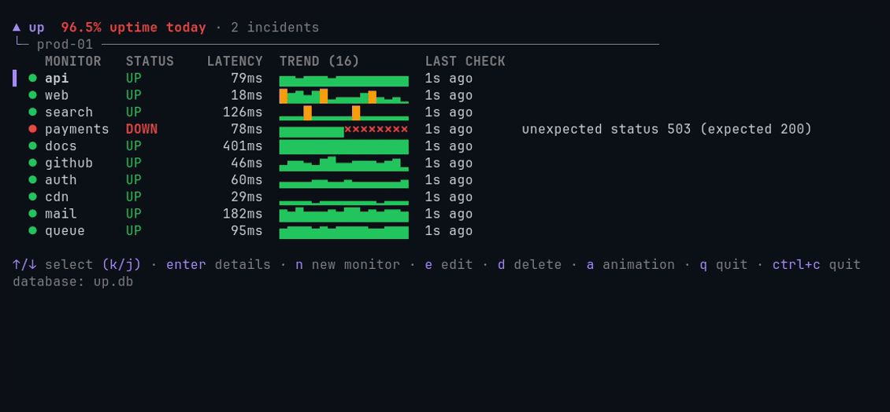

<div align="center">

<h1>
  <picture>
    <source media="(prefers-color-scheme: dark)" srcset="docs/images/banner-dark.svg">
    <source media="(prefers-color-scheme: light)" srcset="docs/images/banner-light.svg">
    
  </picture>
</h1>

Self-hosted HTTP uptime monitor with a terminal UI. One binary and a SQLite file: no database server, no agents, no YAML.

[](https://github.com/giulianotesta7/up/actions/workflows/quality.yml)
[](https://github.com/giulianotesta7/up/actions/workflows/security.yml)

</div>



## Features

- **HTTP checks** with per-monitor interval, timeout and expected status. Redirects are followed. Optional method, headers, body and expected text.
- **TCP checks** that connect to a host and port, for services without an HTTP endpoint.
- **Managed from the TUI.** Add, edit, delete and mute monitors; the daemon picks up changes within ~2s.
- **Remote TUI.** Run the daemon on a server and manage it from your laptop over an authenticated API.
- **Check history.** Every result is stored and outages are derived from it. Results are kept for 30 days by default; retention is configurable.
- **Email and webhook alerts** on down and recovery, with optional thresholds so a single timeout does not wake anyone up.
- **TLS expiry warnings** at 14, 7 and 3 days.
- **Maintenance mute** from 1 minute to 7 days, without stopping checks or history.
- **Recurring maintenance windows** that hold alerts and certificate warnings while checks and history continue.
- **Stale-daemon detection.** If the daemon stops, the TUI says so and keeps the last known statuses instead of marking everything DOWN.

## Install

### Docker

1. Start the daemon:

   ```sh
   git clone https://github.com/giulianotesta7/up.git && cd up
   docker compose up -d
   docker compose logs up | grep 'access token'
   ```

2. [Install the binary](#binary) on your machine and connect:

   ```sh
   up login --url "http://<server ip>:8080"
   up tui --remote    # press n to add your first monitor
   ```

The `up-data` volume holds `up.db`, the SMTP encryption key (`up.db.key`) and the API token hash (`up.db.token`). Back them up together.

> Checks run inside the container, where `localhost` is the container itself. To monitor the host, use `host.docker.internal` with `extra_hosts: ["host.docker.internal:host-gateway"]`, or `network_mode: host`.

### Binary

Linux (amd64/arm64):

```sh
curl -fsSL https://raw.githubusercontent.com/giulianotesta7/up/main/install.sh | sh
```

Run `up serve` and `up tui` in separate terminals, or install a service below.

### systemd

1. Install and start a service:

   **User service** — linger enabled; database at `~/.config/up/up.db`:

   ```sh
   curl -fsSL https://raw.githubusercontent.com/giulianotesta7/up/main/install.sh | sh -s -- --service
   ```

   **System service** — runs as the `up` user; shared database at `/var/lib/up/up.db`:

   ```sh
   curl -fsSL https://raw.githubusercontent.com/giulianotesta7/up/main/install.sh | sh -s -- --system
   ```

2. With `--system`, run `newgrp up` or log in again for group access.

3. Open the TUI (`n` adds a monitor):

   ```sh
   up tui
   ```

Existing databases are not moved automatically. To manage the service from another machine, enable [Remote access](#remote-access).

### Version and uninstall

Pin a version or uninstall (databases, user and group are kept):

```sh
curl -fsSL https://raw.githubusercontent.com/giulianotesta7/up/main/install.sh | sh -s -- --version vX.Y.Z
curl -fsSL https://raw.githubusercontent.com/giulianotesta7/up/main/install.sh | sh -s -- --uninstall
```

### From source

Requires Go 1.26.10:

```sh
go build -o up ./cmd/up
```

## Usage

```sh
up serve        # run checks and store results
up tui          # view and manage monitors on this machine
up tui --remote # manage a remote server (after up login)
```

The database is resolved in this order: `--db`, `$UP_DB`, `/var/lib/up/up.db` if it exists, `~/.config/up/up.db`. The TUI footer shows which one is open. New monitors start with a 30s interval, 5s timeout and expected status 200 until you change the defaults (`f`).

### Keys

`j`/`k` move · `/` search (the footer becomes the prompt · `tab` status: all, down, failing, held · `enter` keep · `esc` clear) · `enter` details · `n` new · `e` edit · `y` duplicate · `d` delete · `m` mute · `u` unmute · `w` maintenance windows · `s` mail servers · `c` channels · `f` defaults · `a` animation · `r` retry now (remote) · `esc` back · `q` quit.

`y` opens the new monitor form filled from the selected monitor, named `<name> copy`. Headers and body stay sealed (`set`, with keep, replace or clear), and history, mute and maintenance windows are not copied. Nothing is saved until `enter`.

In forms: `tab`/`shift+tab` switch fields · `←`/`→` choose · `enter` save · `esc` cancel.

### Monitor fields

Only **name** and **URL** are required; the rest uses the defaults above, with method `GET`. **Advanced** (`space` opens, `←` closes) sets the HTTP request:

| Field | Meaning |
|---|---|
| Method | `GET`, `HEAD`, `POST`, `PUT`, `PATCH`, `DELETE` or `OPTIONS`. |
| Headers | Name/value pairs sent on every check. `space` on `+ Header` adds one, `ctrl+d` removes the focused one. Names must be unique, ignoring case. |
| Request body | Text sent as the body. |
| Expected text | Literal, case-sensitive text the body must contain. The status **and** the text must match. Not allowed with `HEAD`. |

Only the first 1 MiB of a response is read; if the text is not in it, the check fails. Responses are not stored. Latency is the time until the response headers arrive. The detail view shows the method and expected text.

A monitor with headers or a body does not follow a redirect to another scheme, host or port: it goes down saying so, so those values never reach a host you did not configure. Every other redirect is followed.

### TCP monitors

Set `Type` to `TCP` (first field, `←`/`→`) and enter a host (name or IP; IPv6 without brackets) and a port. The monitor is **up** when the connection opens and **down** if it is refused, DNS fails or it times out. Latency is the time to connect, including name resolution.

It only proves that something is listening: no TLS, certificate or application check. TCP monitors have no URL, expected status or `TLS expiry`.

## Alerts

1. `s`: add a mail server. For a relay without authentication, set **No login required** to **Yes**.
2. `c`: add a channel: **email** (that server and one or more comma-separated recipients) or **webhook** (a URL).
3. `e` on a monitor: pick the channel. Monitors without a channel never alert.

`up serve` sends one alert when a monitor goes down and one when it recovers, never one per failed check. **Alert after** and **Recover after** (default 1) set how many consecutive failures or successes are needed; meanwhile the list shows `FAILING 2/3` or `RECOVERING 1/2`. Restarting the daemon preserves the streak and does not resend alerts. Recipients only know what was actually sent: if you pick a channel for a monitor that is already down, the down alert is sent right then (once a mute or maintenance window ends, if one holds it) and the recovery follows normally.

### Notifications

`s` and `c` open one full-screen view with three tabs: **Mail servers**, **Channels** and **Deliveries**. `s` lands on Mail servers and `c` on Channels; `tab`/`shift+tab` switch tabs and `esc` goes back. On the first two tabs `n` adds, `e` edits, `d` deletes and, for a channel, `t` tests; the forms open over the view. Channels shows each channel's last delivery (`✓ sent`, `✗ failed` with the reason, `◷ held` with why, or `—`). Deliveries is the delivery log, newest first, with `↑`/`↓` (`j`/`k`) to scroll and `/` to search monitor, channel, event, outcome and reason (`enter` keeps the search, `esc` clears it). `enter` on a channel opens Deliveries showing only that channel; `esc` clears it. It works the same with `--remote`.

TLS modes: `starttls` (default, usually port 587), `tls` (usually 465) and `none` for relays without login. `none` cannot be combined with a username.

Run `up serve` once before entering SMTP passwords, header values, a request body or a webhook URL to create `up.db.key` (required mode `0600`). **Back up the key with the database**; losing it requires re-entering them.

### Webhook channels

In `c`, set **Kind** to `webhook` (`←`/`→`), then enter the URL and, optionally, an auth header name and value (for example `Authorization` and `Bearer …`). The list shows only the URL's origin. The URL cannot be cleared.

`up serve` sends a JSON `POST` (`User-Agent: up/webhooks`):

```json
{
  "version": 1,
  "event": "monitor.down",
  "occurred_at": "2025-01-02T18:04:05Z",
  "monitor": {"name": "api", "type": "http"},
  "result": {"status": "down", "reason": "status 500", "status_code": 500, "latency_ms": 1500}
}
```

`event` is `monitor.down`, `monitor.recovered`, `cert.expiring` (`result` carries `days_remaining`) or `test` (no `monitor` or `result`; it carries `channel` and `message`). A `2xx` response means delivered. Any other status, a network error or a timeout (10s) is a failure. Redirects are not followed and failures are not retried.

### Delivery log

Every alert delivery is recorded per channel with its time, monitor, event (`monitor.down`, `monitor.recovered` or `cert.expiring`), outcome (`sent`, `failed` or `held` by a mute or maintenance window) and a short reason that never includes passwords, header values or webhook paths. Channel tests are not recorded, and attempts are kept as long as check history. The Deliveries tab shows the latest 200; times omit seconds.

### Testing a channel

On the Channels tab, `t` and then `enter` send a test to the selected channel and show success or the reason it failed. Success means the SMTP server accepted the message (not that it reached the inbox) or the webhook answered `2xx`. A test changes no monitor data, needs `up serve` running and runs one at a time per channel.

### Muting

`m` offers presets and custom durations from 1 minute to 7 days; `u` ends the mute early. Checks and history keep running, and mutes survive restarts.

When the mute ends, recipients only hear what they do not already know: a down alert if it is still down and they were not told, or a recovery alert if they were told about the outage before the mute. An outage that starts and ends during the mute sends nothing.

### Maintenance windows

`w` opens the selected monitor's windows: `a` adds, `e` edits, `d` deletes (up to 20 per monitor). A window repeats weekly on the weekdays you toggle (`←`/`→` move, `space` toggles). It has a local `HH:MM` start, a duration in the same format as a custom mute (`45m`, `2h`, `1h30m`; 1 minute to 7 days) and an IANA zone such as `America/New_York`. A window that runs past midnight is marked "crosses midnight"; the weekdays are the days it starts.

While a window is active or the monitor is muted, alerts and certificate warnings are held. Checks, history and uptime keep counting, so downtime inside a window still lowers uptime. The list shows `◷ until HH:MM` for a window (`⏸` for a mute) and the detail shows the end time.

When everything ends, recipients only hear what they do not already know, once, as after a mute. Overlapping or back-to-back windows, even in different zones, count as one. Certificate warnings due meanwhile are sent afterwards. Edits apply within about 2 seconds and windows survive restarts.

Daylight saving: durations are elapsed time. A start that does not exist that day is skipped; one that happens twice runs once, at its first occurrence.

### Defaults

`f` opens the defaults for new items: the time zone of new maintenance windows, and the channel, interval, timeout, expected status, alert after and recover after of new monitors. The new monitor and new window forms start from them. Existing monitors, channels and windows keep their values, and each window keeps its own zone. Until you save, the defaults are UTC, no channel, 30s, 5s, 200, and 1 and 1. Deleting the default channel makes the default none.

### Certificate expiry

HTTPS monitors get a `CERT` column with the days left (amber under 14, red under 3) and one alert per threshold: 14, 7 and 3 days. A certificate first seen with 2 days left sends one warning, not three. Renewal resets the warnings silently; muting delays them.

Set `TLS expiry` to `off` in a monitor's form to disable certificate tracking and warnings. **TLS validation stays on**: an invalid or expired certificate still fails the check.

## Remote access

Enable the HTTP API:

```sh
up serve --api-listen :8080
```

HTTPS is recommended: HTTP sends the token and data unencrypted. Use a TLS-terminating reverse proxy or a certificate and key:

```sh
up serve --api-listen :8443 --tls-cert cert.pem --tls-key key.pem
```

The certificate and key must be supplied together and require `--api-listen`.

The access token is printed once on the first API start (stderr / service logs). Its hash is stored in `<db>.token` (mode `0600`). Rotate it with `up token reset [--db PATH]`, or in Docker:

```sh
docker compose exec up up token reset
```

### Connect

```sh
up login          # server URL and masked token; saved only if accepted
up tui --remote   # manage the remote server
up logout         # forget it (does not revoke the token)
```

For scripts:

```sh
echo "$TOKEN" | up login --url https://up.example.com --token-stdin
```

Credentials are saved in `$XDG_CONFIG_HOME/up/remote.json` (default `~/.config/up/remote.json`), mode `0600`. `--remote` cannot be combined with `--db`. Disconnections retry automatically; `r` retries immediately. Self-signed certificates need system trust.

### API reference

Every route requires `Authorization: Bearer <token>`; tokens in URLs are not accepted. Unauthenticated requests return `401`.

| Request | Does |
|---|---|
| `GET /api/v1/ping` | validates the token and server identity |
| `GET /api/v1/snapshot` | returns everything the TUI shows |
| `POST /api/v1/checks`, `PUT`/`DELETE /api/v1/checks/{name}` | adds, edits or deletes a monitor (names cannot change). `POST` accepts an optional `copy_from` (a monitor name): header values and body the request keeps come from that monitor, sealed on the server; `404` if it does not exist |
| `PUT`/`DELETE /api/v1/checks/{name}/mute` | mutes (`duration_ms`, 1 minute to 7 days) or unmutes |
| `POST /api/v1/smtp-servers`, `PUT`/`DELETE /api/v1/smtp-servers/{name}` | manages SMTP servers |
| `POST /api/v1/channels`, `PUT`/`DELETE /api/v1/channels/{name}` | manages channels |
| `GET`/`POST /api/v1/checks/{name}/maintenance`, `PUT`/`DELETE .../maintenance/{id}` | lists, adds, edits or deletes a monitor's maintenance windows (`weekdays` 0=Sunday, `start_minute`, `duration_ms`, `zone`); active windows hold alerts and certificate warnings |
| `GET`/`PUT /api/v1/defaults` | reads or replaces the defaults for new items (`zone`, `channel`, `interval_ms`, `timeout_ms`, `expected_status`, `alert_after`, `recover_after`); the snapshot carries them too |
| `GET /api/v1/deliveries` | lists alert delivery attempts, newest first, as `{"server_time", "attempts": [{at, monitor, channel, event, outcome, reason}]}`; optional `monitor`, `channel` and `limit` (default 50, at most 500) query parameters; the snapshot carries the latest ones too |
| `POST`/`GET /api/v1/channels/{name}/test` | requests a channel test (`202`, or `409` while one is active) and reads the newest one; the daemon sends it |

Bodies are strict JSON, limited to 1 MiB. Errors: `400` invalid input, `404` not found, `409` duplicate or still in use. Rejected requests change nothing.

### Security

- **One token, full access.** There are no roles or rate limiting. For an internet-facing API, a proxy with rate limiting is recommended.
- SMTP passwords, header values, request bodies, webhook URLs and webhook auth values are sealed with the server's public key; the API rejects plaintext values and never returns them or their ciphertext. The private key stays on the server. Edit forms show saved values as `set`, with keep, replace or clear.
- The server stores a SHA-256 token hash and compares it in constant time. Token and remote credential files readable by others are refused.
- The client does not follow redirects or forward the token to another host. Server text is stripped of terminal escape sequences before display. There is no certificate pinning.

## Configuration

A command-line flag overrides its environment variable.

| Flag | Variable | Command | Default |
|---|---|---|---|
| `--db PATH` | `UP_DB` | `serve`, `tui`, `token reset` | [database resolution](#usage) |
| `--retention DURATION` | `UP_RETENTION` | `serve` | `720h` (`0` keeps everything) |
| `--api-listen ADDR` | `UP_API_LISTEN` | `serve` | off |
| `--tls-cert FILE` | `UP_TLS_CERT` | `serve` | |
| `--tls-key FILE` | `UP_TLS_KEY` | `serve` | |
| `--remote` | `UP_REMOTE` | `tui` | `false` |
| `--url URL` | | `login` | |
| `--token-stdin` | | `login` | `false` |

## Contributing

Read [CONTRIBUTING.md](CONTRIBUTING.md) for the required issue-first workflow, development checks and PR conventions.

## License

MIT
